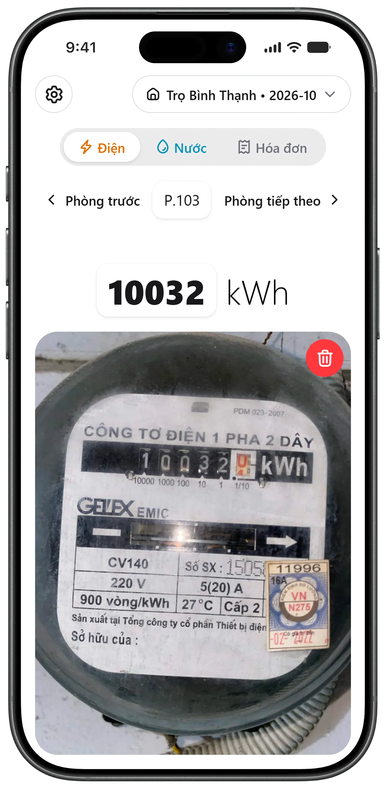
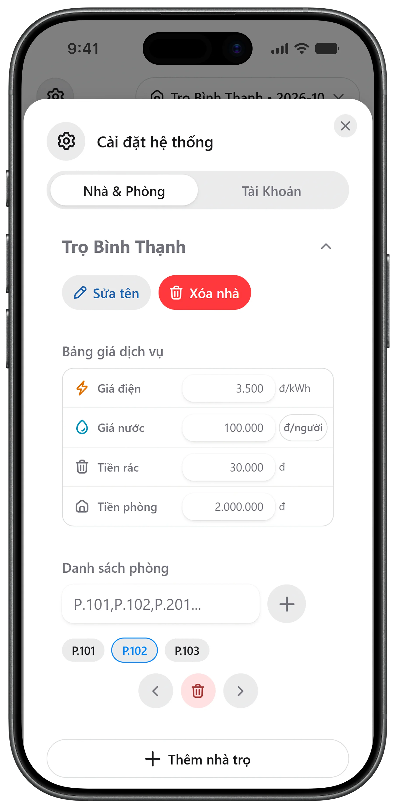
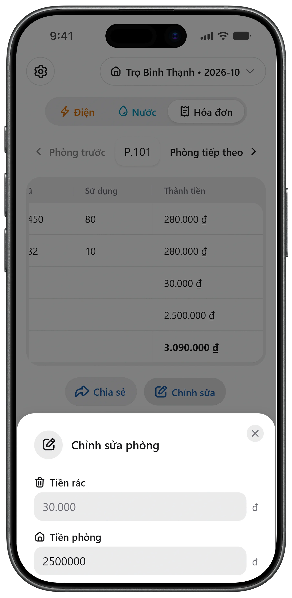

# 

> A modern, mobile-first web application designed for boarding house landlords to streamline utility meter tracking with Gemini AI OCR, automate room rental calculations, and export bills directly via any messaging apps or CSV/Excel reports.

[](https://lehoangtrieu-dev.github.io/hoa-don-tro/)
[](https://react.dev/)
[](https://www.typescriptlang.org/)
[](https://vite.dev/)
[](https://heroui.com/)
[](https://tailwindcss.com/)

---

## 📸 Preview

<table>
  <tr>
    <td></td>
    <td></td>
    <td></td>
  </tr>
</table>

### 🧾 Sample Invoice Breakdown

Each room's bill is calculated and rendered directly into an exportable card:

| P.101 / 2026-10              | Mới _(Current)_ | Cũ _(Previous)_ |  Sử dụng _(Usage)_   | Thành tiền _(Subtotal)_ |
| :--------------------------- | :-------------: | :-------------: | :------------------: | ----------------------: |
| **Số điện** _(Electricity)_  |      1530       |      1450       |        80 kWh        |               280.000 ₫ |
| **Số nước** _(Water)_        |       142       |       132       | 10 m³ _(or 2 người)_ |               280.000 ₫ |
| **Tiền rác** _(Trash Fee)_   |        —        |        —        |          —           |                30.000 ₫ |
| **Tiền phòng** _(Room Rent)_ |        —        |        —        |          —           |             2.500.000 ₫ |
| **Tổng cộng** _(Total)_      |                 |                 |                      |         **3.090.000 ₫** |

#### 📐 Calculation Formulas

```math
\begin{aligned}
\text{Electricity Cost} &= (\text{Meter}_{\text{new}} - \text{Meter}_{\text{old}}) \times \text{Rate}_{\text{kWh}} \\
\text{Water Cost (Consumption)} &= (\text{Meter}_{\text{new}} - \text{Meter}_{\text{old}}) \times \text{Rate}_{\text{m}^3} \\
\text{Water Cost (Headcount)} &= \text{Tenant Count} \times \text{Rate}_{\text{person}} \\
\text{Total Bill} &= \text{Cost}_{\text{electricity}} + \text{Cost}_{\text{water}} + \text{Fee}_{\text{trash}} + \text{Price}_{\text{room}}
\end{aligned}
```

---

## ✨ Features

- ⚡ **Automated AI Meter OCR**: Snap a photo of mechanical or digital electricity/water meters; Google Gemini automatically identifies digits, filters decimal dials, and fills input fields instantly.
- 🗜️ **Client-Side Canvas Compression**: Automatically resizes and compresses high-resolution smartphone photos down to ~200KB directly in the browser via HTML5 Canvas before uploading, ensuring instantaneous uploads and optimal AI processing.
- 📱 **Mobile-First & Zero-Scroll UX**: Ergonomically crafted for single-handed mobile navigation. Easily cycle through 40+ rooms without tedious vertical scrolling.
- 🧮 **Two-Tier Pricing & Flexible Billing Architecture**:
  - **House Level**: Configure shared utility rates (Electricity per kWh, Water rate, default trash fee, and default room rental).
  - **Flexible Water Billing**: Quick one-click toggle between cubic meter (`đ/m³`) consumption and per-person headcount (`đ/người`).
  - **Room Level**: Granular overrides for specific rooms (custom room price, custom trash fee, and individual tenant headcount for per-person water billing).
- ↕️ **Custom Physical Route Reordering**: Reorder room sequences freely using thumb-friendly control buttons to match landlords' physical walking routes.
- 📤 **Multi-Channel Exporting**:
  - Export crisp, high-resolution (2x scale) invoice images directly to tenants via Zalo, Messenger, or native Web Share API.
  - Download complete house billing spreadsheets in **UTF-8 BOM CSV** format, fully compatible with Microsoft Excel without Vietnamese font corruption.
- ☁️ **Cloud Synchronization & Offline-First**:
  - Google Sign-In with Firebase Authentication.
  - Automatic Firestore cloud sync powered by an intelligent debounce queue to conserve write quotas.
  - Image hosting on Cloudinary using unsigned client uploads.
  - Instant offline responsiveness backed by local cache (`localStorage`).

---

## 🛠️ Tech Stack

- **Framework**: [React 19](https://react.dev/) & [TypeScript](https://www.typescriptlang.org/)
- **Build Tool**: [Vite 8](https://vite.dev/)
- **Styling**: [Tailwind CSS v4](https://tailwindcss.com/) & [HeroUI v3](https://heroui.com/)
- **Icons**: [@gravity-ui/icons](https://gravity-ui.com/icons)
- **AI / OCR**: [@google/genai](https://www.npmjs.com/package/@google/genai)
- **Backend & Auth**: [Firebase](https://firebase.google.com/) (Auth & Firestore)
- **Media Hosting**: [Cloudinary](https://cloudinary.com/) REST API
- **Rendering & Export**: `modern-screenshot` & Vanilla UTF-8 CSV Streamer

---

## 🚀 Getting Started

### 1. Clone the repository

```bash
git clone https://github.com/lehoangtrieu-dev/hoa-don-tro.git
cd hoa-don-tro
```

### 2. Install dependencies

```bash
npm install
```

### 3. Run development server

```bash
npm run dev
```

### 4. Build for production

```bash
npm run build
```

---

## ⚙️ Configuration

1. **Gemini API Key**: Open the Settings modal (⚙️ icon) in the app ➡️ **Account** tab ➡️ Paste your personal Gemini API Key and select your preferred model (e.g. `gemini-2.5-flash`).
2. **Cloudinary**: Replace your `CLOUD_NAME` and `UPLOAD_PRESET` (Unsigned mode) inside [src/components/MeterPhoto.tsx](file:///C:/Users/NoobTrieu/Documents/Code/Web/HoaDonTro/src/components/MeterPhoto.tsx).
3. **Firebase**: Update the `firebaseConfig` object inside [src/services/firebase.ts](file:///C:/Users/NoobTrieu/Documents/Code/Web/HoaDonTro/src/services/firebase.ts).

---

## 📄 License

Created with ❤️ for real-world family rental management. Distributed under the [MIT License](./LICENSE.md).
